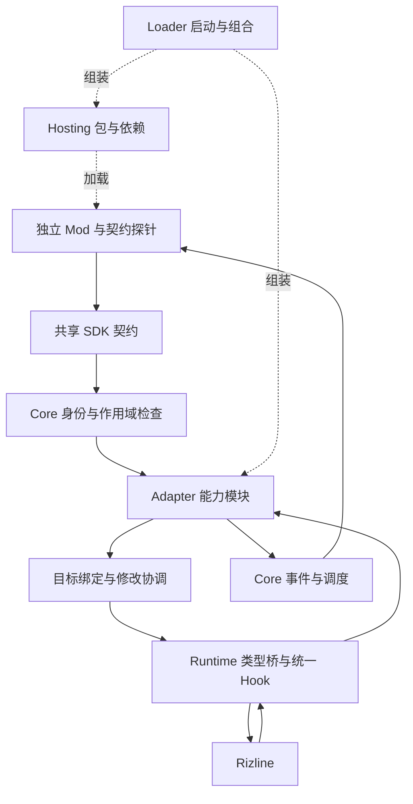

# Architecture: foundation-expansion

## Directory Structure

沿用六个现有工程。下列括号内目录是下一阶段建议的内部模块，按任务需要创建，不预先生成空项目。

```text
riz_toolbox/
├── src/
│   ├── RizToolbox.Sdk/       (Plugins, Capabilities, Events, Game, Resources, Ui, Content)
│   ├── RizToolbox.Core/      (Scopes, Scheduling, Mutation, Services, Diagnostics)
│   ├── RizToolbox.Hosting/   (Packages, Contracts, Migrations)
│   ├── RizToolbox.Runtime/   (Interop, Handles, Hooks, UnityBridge)
│   ├── RizToolbox.Adapter/   (Bindings, Modules, Targets, Profiles)
│   └── RizToolbox.Loader/    (Composition, Startup, Commands)
├── examples/                独立契约探针；无需扩展成业务产品
├── tests/                   离线回归、包隔离、原生边界与集成证据采集
├── scripts/                 构建、安装、卸载、验证
├── docs/                    正式 SDK 文档及 validation/ 证据
└── .docs/
    ├── compatibility-foundation/   0.2 基线与遗留验收
    └── foundation-expansion/       本轮补全计划与设计
```

不要因为能力增多，就给每个服务建立一个独立程序集。先用清晰命名空间、模块注册和依赖测试维持边界；只有需要独立版本/分发时才拆包。

## System Overview

以下为逻辑调用图，图中的 SDK 是接口契约，实际实现由 Core 或 Adapter 提供。



源代码依赖：Sdk 不引用游戏或其他项目；Core → Sdk；Hosting → Core/Sdk；Runtime 保持独立的游戏无关实现；Adapter → Runtime/Core/Sdk；Loader 组合所有层；普通 Mod → Sdk。版本差异留在 Adapter，原生调用细节留在 Runtime。架构检查拒绝 Core 引用 Adapter/Runtime、Loader 引用 examples 或普通插件引用宿主内部程序集。

## Components

| 组件 | 职责与输入 | 输出 | 依赖与规格 |
|---|---|---|---|
| Sdk | 版本化契约、生命周期、DTO、句柄及错误 | 作者可引用的稳定类型 | 无游戏引用；B03、B09–B17 |
| Core | 启用意愿、能力变化、作用域与变更请求 | 启停、调度、代理、事件与仲裁结果 | Sdk；B04–B05、B08、B17–B18 |
| Hosting | 插件清单、包目录、契约依赖 | 独立加载上下文、验证后的插件与诊断 | Core/Sdk；B04、B17、B19 |
| Runtime | 受验证签名、线程入口、对象/原生句柄 | 类型正确的调用、单次挂接及受控回调 | 已锁定的运行时依赖；B02、B07 |
| Adapter | 构建配置、符号探测、游戏对象状态 | 能力实现、语义目标、普通数据事件 | Runtime/Core/Sdk；B01、B06–B16 |
| Loader | 启动参数、安装目录、模块清单 | 组装好的宿主和诊断入口 | 只做组合；B06、B18–B19 |

Adapter 内部模块建议按 Scene、Run、Catalog、Judgement、Timing、Targets、Visual、UiInput、Audio、Content、Settings 拆分。每个模块有独立探测、注册和释放路径。任何模块都不能直接决定某个示例插件是否启用。

## Data Flow

1. Loader 校验安装与构建身份，Runtime 验证必要入口；Hosting 完成包预检。
2. Adapter 模块在主线程探测目标，将有证据的能力注册到 Core。Core 根据用户意愿和依赖启用插件。
3. 插件通过作用域服务发出读取、订阅或修改请求；Core 校验身份、线程、能力版本和代次。
4. 读取返回普通快照；观察返回自动清理订阅；修改先经目标定位和 B08 仲裁，再由 Adapter 执行。
5. Runtime 的已验证回调转换成游戏模块输入；Adapter 复制数据、维护序号/局状态，Core 向插件分发。
6. 停用、场景结束或能力撤回时，先阻止新操作，再取消任务与回调，最后释放租约与对象根。能力恢复时创建新代次，旧服务永不重新有效。

## Tech Stack

| 层 | 当前技术基线 | 下一阶段原则 |
|---|---|---|
| SDK、宿主、适配器 | C#、net6.0；SDK 8 构建 | 延续现有目标；升级运行时作为独立兼容变更 |
| 游戏入口 | Doorstop、CoreCLR、Dobby，现有锁文件 | 不同时叠加第二套加载链来补功能 |
| Unity/IL2CPP | 原生导出 API 与当前版本签名 | 验证 ABI 与实际调用路径，能力化开放 |
| 持久数据 | 插件目录中的 JSON 与文件 | schema 迁移、原子写、大小限制，不为底层引入服务端 |
| 验证 | 现有 .NET 测试程序、PowerShell、真实游戏日志 | 补契约、ABI、生命周期、冲突与性能测试 |

## API Contracts

以下为设计中的契约形状，不是当前可编译 API；实际命名在 B03 收敛后才加入 SDK。

| 契约 | 关键内容 | 返回/失效规则 | 规格 |
|---|---|---|---|
| CapabilityInfo | ID、版本、可用性、代次、所需场景、验证级别、原因 | 不可用与未实现可区分；不以有接口等同可用 | [B06](SPEC.md#b06-adapter-capabilities) |
| Scope/TaskHandle | 所有者、父作用域、取消信号、代次 | Dispose 幂等；异步完成再次校验代次 | [B05](SPEC.md#b05-scopes-and-scheduling) |
| TargetHandle | 语义键、对象代次、类型、支持操作 | 同名歧义拒绝；对象失效不能指向后来复用的地址 | [B12](SPEC.md#b12-object-targeting) |
| MutationLease | 目标/属性、策略、优先级、所有者、有效期 | 所有者可撤回；基线/冲突由目标策略处理 | [B08](SPEC.md#b08-mutation-coordination) |
| HookDescriptor | 目标与 ABI、阶段、签名版本、允许变更、线程 | 普通插件无地址；不支持签名提前失败 | [B07](SPEC.md#b07-hook-broker) |
| EventEnvelope | 源、序号、场景代次、RunId、时间与精度 | 把采样观察与精确回调区分，迟到消息可拒绝 | [B09](SPEC.md#b09-lifecycle-events) |
| ContentProvider | 提供者 ID、内容类型/版本、命名空间、解析/加载 | 校验成功后原子发布，进行中租约仍有所有权 | [B15](SPEC.md#b15-audio-and-content-providers) |
| ServiceContract | 服务 ID、接口版本、共享契约身份、提供者代次 | 提供者撤回使旧代理失效 | [B17](SPEC.md#b17-inter-plugin-contracts) |

内部适配扩展契约与普通 Mod SDK 分开：扩展包可声明经验证的新绑定和能力模块；宿主统一校验构建、签名、共享契约、归属和生命周期。初期先在 Adapter 内完成注册接口，再在确有独立适配包时拆出单独的适配契约程序集。普通插件不能靠引用内部类绕过代理。

## Architecture decisions

2026-10-22补充：[InFalsusTools源码对照](../../docs/2026-10-22_架构-InFalsusTools-reference-report.md)。采用统一数据/算法供多种入口复用、配置与策略独立交付、集中呈现状态的设计。沿用既有SDK、DLL插件、版本化服务和ToolboxHost设置/状态后端；业务策略放插件层，游戏绑定继续由Runtime/Adapter验证。外部500ms场景轮询不替代LOCAL结果Start保存之前的精确归属与接管。当前仍优先完成LOCAL事务，不因参考项目另起技术栈或管理器产品。

| 决策 | 选择 | 理由与边界 |
|---|---|---|
| 公共 API 粒度 | 高频用途用强类型服务，冷门目标走登记式扩展点 | 避免底层只覆盖几个业务案例，也避免任意反射/地址操作失去兼容边界 |
| Hook 修改方式 | 按目标声明能力，统一仲裁 | 不是任意方法都能安全跳过、组合或卸钩 |
| 资源与对象身份 | 语义身份＋对象代次＋租约 | 允许对象重建，不复用旧指针和旧恢复值 |
| 实验能力 | 独立版本及验证标签 | 作者可使用，维护者仍能准确表达范围 |
| 稳定 API 变更 | 新接口/新版本；旧二进制回归 | 固定程序集身份不等于随意改签名仍兼容 |
| 单局状态 | 精确来源优先，采样明确降级 | 本次开局漏报证明有状态类和单元测试还不够 |
| 性能 | 统一扫描/缓存、事件驱动、测量后定预算 | 不让每个插件重复枚举所有 Unity 对象 |
| 特定控制不可用 | 细分能力并给出原因 | 不为追求“全覆盖”开放空实现或危险的默认成功 |

## External Dependencies

| 依赖 | 作用 | 当前锁定信息 |
|---|---|---|
| Doorstop/CoreCLR/Dobby 分发包 | 托管入口、运行时、原生桥 | `dependencies.lock.json` 中 `6.0.0-be.789+6cea286` 和 SHA-256 |
| Rizline 本机构建 | 唯一已验证游戏版本 | Steam build 25977441，Unity 2022.3.62f2，win-x64 |
| 游戏构建配置 | 绑定与版本选择 | `src/RizToolbox.Adapter/profiles/steam-25977441.json` |

上述只记录本地已用版本，不是对外部最新版本的推荐。新依赖或版本升级须单列必要性、绑定变化和回归证据。
